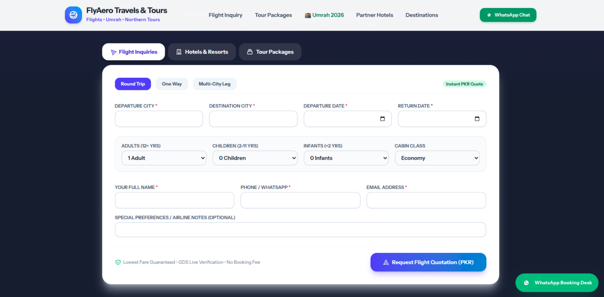
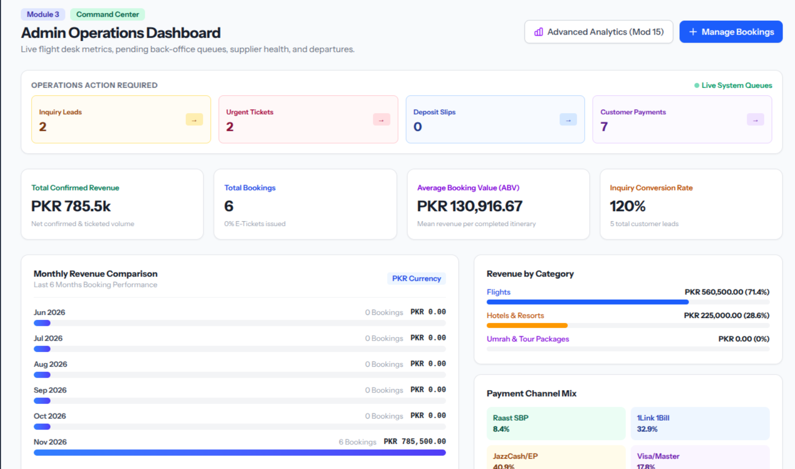
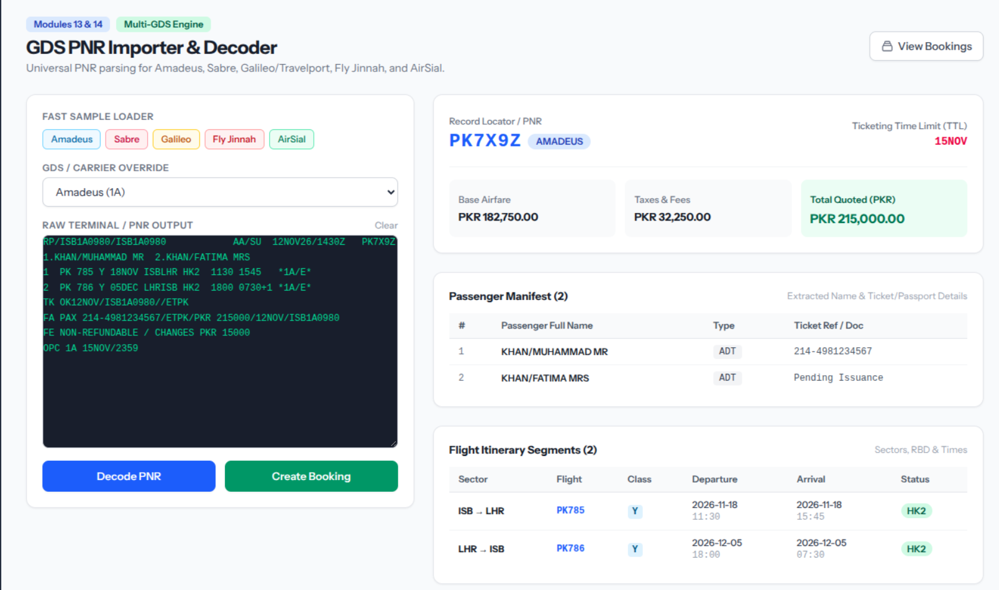

# FlightDesk PK — Flight Booking & Ticket Management System
### Enterprise Travel Agency Management & B2B Consolidator Platform

[](https://laravel.com)
[](https://livewire.laravel.com)
[](https://tailwindcss.com)
[](https://php.net)
[](https://mysql.com)
[](#running-the-development-servers--tests)
[](#)

---

[)](#)

## 1. Project Overview & Purpose

**FlightDesk PK** is a production-grade, full-stack travel agency management software and B2B airline consolidator platform tailored specifically for the Pakistani aviation and tourism market. 

Traditional travel agencies in Pakistan frequently wrestle with disparate Global Distribution System (GDS) green-screen terminals, manual offline ticket queues, fragmented sub-agent credit line management, and unintegrated local payment clearing channels. **FlightDesk PK** solves these operational bottlenecks by unifying consumer-facing booking portals, universal GDS PNR decoders, double-entry agency financial ledgers, and automated Pakistani clearing rails into an integrated back-office operating system.

### Key Value Propositions
- **Native PKR Financial Precision:** All pricing, airfare calculations, taxes, ancillaries, markups, credit limits, and ledgers run natively in Pakistani Rupees (`PKR`).
- **Pakistani Clearing Rails:** First-class settlement support for **State Bank of Pakistan (SBP) Raast P2P/P2M**, **1Link 1Bill & IBFT**, **JazzCash**, **EasyPaisa**, and **3D Secure Visa/Mastercard**.
- **Regulatory & Licensing Compliance:** Automated tracking for Department of Tourist Services (**DTS License**), Federal Board of Revenue National Tax Number (**NTN**), and Sales Tax Registration Number (**STRN**).
- **Consolidator B2B Credit Architecture:** Real-time overdraft limits, operating capital balances, sub-agent balance transfers, and bank deposit receipt approvals.
- **Universal Multi-GDS Parser:** High-speed regex and token parsing engine capable of decoding raw terminal outputs from legacy GDSs and Pakistani domestic carriers.

---

## Visual Showcase / UI Screenshots

> *Project screenshots captured from the live application.*

### 🖥️  Customer Portal Homepage


### 📋  Admin DashBoard Preview 


### 💬 GDS-decoder



---

## 2. Official Technology Stack

```
   ┌────────────────────────────────────────────────────────────────────────┐
   │                            CLIENT BROWSER                              │
   │           Blade Views  │  Livewire 4 Components  │  Alpine.js          │
   │                        Tailwind CSS 4 (@tailwindcss/vite)              │
   └───────────────────────────────────┬────────────────────────────────────┘
                                       │ Real-Time Wire Engine
   ┌───────────────────────────────────▼────────────────────────────────────┐
   │                         LARAVEL 13 BACKEND                             │
   │               MVC Framework + Strict Service-Layer Logic               │
   │    ┌───────────────────┬───────────────────┬──────────────────────┐    │
   │    │  GdsParserService │   BookingService  │ OfflineTicketService │    │
   │    ├───────────────────┼───────────────────┼──────────────────────┤    │
   │    │ PaymentService    │DepositLedgerServ. │ DashboardAnalytics   │    │
   │    └───────────────────┴───────────────────┴──────────────────────┘    │
   └───────────────────────────────────┬────────────────────────────────────┘
                                       │ Eloquent ORM & Query Builder
   ┌───────────────────────────────────▼────────────────────────────────────┐
   │                            MYSQL DATABASE                              │
   │   Bookings │ Payments │ Agency Nodes │ Deposits │ Inquiries │ Catalogs  │
   └────────────────────────────────────────────────────────────────────────┘
```

- **Backend Framework:** **Laravel 13** running on **PHP 8.3+** with strict typing and modern constructor property promotions.
- **Architecture Pattern:** Decoupled **MVC + Service-Layer Architecture**, keeping controllers and Livewire components thin while encapsulating transactional business logic into reusable service classes.
- **Reactive Frontend Engine:** **Livewire 4** and **Alpine.js** delivering single-page application (SPA) responsiveness, real-time input debounce, modal management, and dynamic filters without frontend framework overhead.
- **Design System & Styling:** **Tailwind CSS 4** powered by `@tailwindcss/vite`, optimized for mobile responsiveness and enterprise data density.
- **Database & Persistence:** **MySQL 8.0+** with transactional safety, indexed foreign keys, and decimal precision for currency amounts.
- **Automated Testing Suite:** **PHPUnit 11** with 131 comprehensive feature and unit tests (465 assertions) running against SQLite in-memory and MySQL databases.
- **Code Standards & Formatting:** **Laravel Pint** (Agent/PSR-12 standard) strictly enforced across all files.

---

## 3. Core Architecture & Implemented Modules

The application is structured into **16 operational modules** covering consumer-facing sales, back-office operations, GDS integrations, and B2B treasury accounting:

### A. Consumer Sales & Lead Capture
- **Customer Portal & Omni-Search (Module 1):** Responsive public homepage featuring tabbed search filters across flights, hotels, and holiday packages, regional showcases (Northern Pakistan, Middle East, Central Asia, Europe), customer testimonials, partner airlines ribbon, and a floating WhatsApp support trigger linked dynamically to agency settings.
- **Interactive Flight Inquiry System (Module 2):** Real-time booking inquiry generator supporting **One-Way**, **Round-Trip**, and **Multi-City Leg Builders**. Includes automated passenger counters (Adults, Children, Infants), cabin class selection (Economy, Premium Economy, Business, First), date constraints, and instant reference generation (`INQ-2026-XXXX`).
- **Flight Inquiry Management Inbox (Module 5):** Back-office inquiry desk featuring status tabs (`Pending`, `Contacted`, `Quoted`, `Booked`), customer contact lookups, PKR quote pricing injection, and fast inquiry-to-booking conversions.

### B. Global Distribution (GDS) & Itinerary Parsing
- **Universal GDS PNR Importer & Decoder (Modules 13 & 14):**
  - Instant decoding of complex terminal PNR strings from **Amadeus (1A)**, **Sabre (1S)**, and **Galileo/Travelport (1G)**.
  - Native parsing for Pakistani carriers: **Fly Jinnah (9P NDC)** and **AirSial (PF Direct API)**.
  - Automatic token extraction: Record locator, passenger names and types (ADT/CHD/INF), ticket numbers, flight sectors, booking classes (RBD), scheduled departure/arrival times, Ticketing Time Limits (TTL), fare breakdown (Base Fare, Taxes, Total PKR), and baggage/endorsement rules.
  - **1-Click Booking Generation:** Converts decoded GDS PNRs into confirmed database booking records instantly.

### C. Booking & Offline Ticketing Operations
- **Centralized Booking Management (Modules 7 & 8):** Unified hub tracking **Flight**, **Hotel**, and **Group / Umrah** bookings. Features multi-attribute searches (Reference, PNR, Customer Name, Phone, Ticket Number), travel date filters, passenger manifest modals, electronic ticket issuance (`214-XXXXXXXXXX`), status workflows (`Confirmed`, `Ticketed`, `Pending`, `Cancelled`, `Expired`), and streaming UTF-8 CSV exports.
- **Offline Ticketing & Refund Queue (Modules 15 & 16):** Back-office queue for manual ticket processing, airline schedule change notices, ticket voids, and cancellations. Features an **Urgent Priority Workflow** with visual escalation indicators, handling officer assignments, penalty deductions, and automated payment status synchronization.

### D. B2B Consolidator Ledger & Treasury
- **Agency Deposit & Credit Ledger (Modules 17 & 18):**
  - Manages B2B branch networks, sub-agent hierarchies, and franchise nodes.
  - Tracks live cash balances, overdraft credit limits, and total available operating capital.
  - Multi-bank top-up slip recording (HBL, Meezan Bank, MCB, UBL, Bank Alfalah, Raast) with dual-step cashier verification.
  - Sub-agent balance allocation transfers with atomic debit/credit accounting.
  - Complete double-entry audit ledger with running balance calculations and CSV downloads.

### E. Pakistan Multi-Channel Payment Engine
- **Payment Management & Clearing (Module 14):**
  - End-to-end payment tracking across domestic banking rails: **Raast SBP Instant (0% fee)**, **1Link 1Bill interbank transfers**, **JazzCash mobile wallets**, **EasyPaisa digital wallets**, and **3DS Credit/Debit cards**.
  - Automatic gateway fee and net settlement calculations.
  - Verification triggers that automatically reconcile customer accounts and update linked booking records to `Paid`.

### F. Executive Command & Analytics
- **Admin Operations Dashboard (Module 3):** High-level operations center featuring gross revenue KPIs, booking volumes, average booking value (ABV), inquiry conversion rates, pending operations alerts, live upcoming departures, airline industry notices, and real-time GDS connectivity health monitors.
- **Advanced Analytics & Financial Reporting (Module 15):** 6-month historical monthly comparisons, product vertical revenue share (Flights vs. Hotels vs. Tour Packages), payment channel market penetration, top-grossing sector leaderboards, customer acquisition unit economics, and 1-click executive CSV reports.

### G. Catalogs & Corporate Settings
- **Destination Management (Module 12):** Domestic and international travel destinations with regional grouping (Northern Pakistan, Middle East, Central Asia, Europe) and active status toggles.
- **Hotel & Resort Management (Module 13):** Star-rated hotel properties linked to destinations, nightly PKR rates, room inventory, and partner contract flags.
- **Tour & Umrah Package Management (Module 11):** Featured group itineraries, Umrah seasonal packages, difficulty ratings, duration, pricing, and day-by-day JSON itineraries.
- **Agency Legal & Branch Settings (Module 16):** Centralized corporate configuration: Business name, DTS License number, FBR NTN & STRN, official phone/email, physical address, default currency (`PKR`), and floating WhatsApp customer support integration.

---

## 4. Installation & Local Setup Guide

Follow these steps to set up the project locally on your development machine:

### Prerequisites
- **PHP:** 8.3 or higher with extensions: `pdo_mysql`, `curl`, `mbstring`, `xml`, `bcmath`, `zip`.
- **Composer:** 2.6+
- **Node.js & NPM:** Node 20+ and NPM 10+
- **MySQL Database Server:** 8.0+

### Step-by-Step Installation

```bash
# 1. Clone the repository
git clone https://github.com/your-username/Flight-Booking-System.git
cd Flight-Booking-System

# 2. Install PHP backend dependencies
composer install

# 3. Install frontend JavaScript dependencies
npm install

# 4. Create your local environment configuration
cp .env.example .env

# 5. Generate application encryption key
php artisan key:generate
```

### Configure Database & Currency Settings
Edit `.env` to match your local MySQL server credentials:

```dotenv
DB_CONNECTION=mysql
DB_HOST=127.0.0.1
DB_PORT=3306
DB_DATABASE=travel_agency
DB_USERNAME=your_mysql_user
DB_PASSWORD=your_mysql_password

# Default System Currency
APP_CURRENCY=PKR
```

### Run Migrations & Comprehensive Seeders
Execute database migrations and seed realistic Pakistani travel agency records, destinations, tour packages, GDS bookings, and B2B ledger transactions:

```bash
php artisan migrate --seed
```

---

## 5. Running the Development Servers & Tests

### Start Backend Server
```bash
php artisan serve
# Application live at: http://127.0.0.1:8000
```

### Compile & Watch Frontend Assets (Vite & Tailwind CSS 4)
```bash
# Development hot-reload
npm run dev

# Or build optimized production bundles
npm run build
```

### Execute Automated Test Suite
Run the 131 automated feature and unit tests with PHPUnit:

```bash
# Run all feature tests
php artisan test

# Run tests with code coverage or filter by specific module
php artisan test --filter=GdsParserServiceTest
php artisan test --filter=BookingLivewireTest
php artisan test --filter=PaymentLivewireTest
```

### Enforce Code Standards with Laravel Pint
```bash
vendor/bin/pint --test
```

---

## 6. Admin Dashboard Access Routes

All administrative operations and transaction engines are accessible under the `/admin` route group:

| Route URI | Named Route | Module ID | Functional Description |
|---|---|---|---|
| `/admin` or `/admin/dashboard` | `admin.dashboard` | **Module 3** | **Executive Command Center:** Live revenue KPIs, pending operational ribbons, GDS health monitor, and upcoming departures. |
| `/admin/analytics` | `admin.analytics` | **Module 15** | **Advanced Analytics:** 6-month revenue trends, product vertical mix, payment gateway shares, and CSV reporting. |
| `/admin/bookings` | `admin.bookings` | **Modules 7 & 8** | **Booking Hub:** Centralized flight, hotel, and group bookings, search, filters, e-ticket issuance, and CSV exports. |
| `/admin/gds/importer` | `admin.gds.importer` | **Modules 13 & 14** | **Universal GDS Decoder:** Terminal PNR parser for Amadeus, Sabre, Galileo, Fly Jinnah, and AirSial with 1-click booking creator. |
| `/admin/ticketing/queue` | `admin.ticketing.queue` | **Modules 15 & 16** | **Offline Ticketing Queue:** Urgent priority tickets, cancellations, refunds, voids, schedule changes, and airline filters. |
| `/admin/ledger` | `admin.ledger` | **Modules 17 & 18** | **B2B Deposit Ledger:** Agency node balances, overdraft credit limits, deposit top-ups, and sub-agent fund transfers. |
| `/admin/payments` | `admin.payments` | **Module 14** | **Payment Management:** SBP Raast, 1Link, JazzCash, EasyPaisa, and Card reconciliation and settlements. |
| `/admin/inquiries` | `admin.inquiries` | **Module 5** | **Flight Inquiry Desk:** Status tabs, price quoting in PKR, and customer lead management. |
| `/admin/destinations` | `admin.destinations` | **Module 12** | **Destination Catalog:** Domestic & international travel regions management. |
| `/admin/hotels` | `admin.hotels` | **Module 13** | **Hotel Management:** Destination-linked properties, room types, and nightly PKR rates. |
| `/admin/packages` | `admin.packages` | **Module 11** | **Tour Package Hub:** Adventure tours, featured packages, and Umrah seasonal allocations. |
| `/admin/settings` | `admin.settings` | **Module 16** | **Agency Settings:** Business profile, DTS license, NTN/STRN, and WhatsApp customer support configuration. |
| `/` | `home` | **Module 1** | **Public Customer Portal:** Search engine, trip inquiry modal, testimonials, and holiday package showcases. |

---

## 7. Design Patterns & Best Practices

- **Strict Service Layer:** All transactional operations (e.g. `PaymentService`, `BookingService`, `GdsParserService`, `DepositLedgerService`) are isolated from controllers and Livewire components, ensuring full testability and code reusability.
- **Atomic Database Transactions:** Multi-step financial operations—such as sub-agent balance allocations, ticket debit charges, and payment verification reconciliations—are wrapped inside `DB::transaction()` blocks to prevent data inconsistency.
- **Defensive Type Safety:** Full PHP 8.3 type declarations on all parameters and return types, with explicit model attribute casts (`decimal:2`, `datetime`, `array`).
- **Clean Tailwind CSS 4 Theming:** Built with Tailwind CSS 4 utilizing semantic badge colors, micro-interactions, responsive sidebars, and accessible data tables.

---

## 8. License & Author

- **Project:** Flight Booking and Ticket Management System (FlightDesk PK)
- **Architecture & Implementation:** Developed for B2B Travel Consolidators & Travel Agencies in Pakistan.
- **License:** Open-sourced under the [MIT License](LICENSE).
